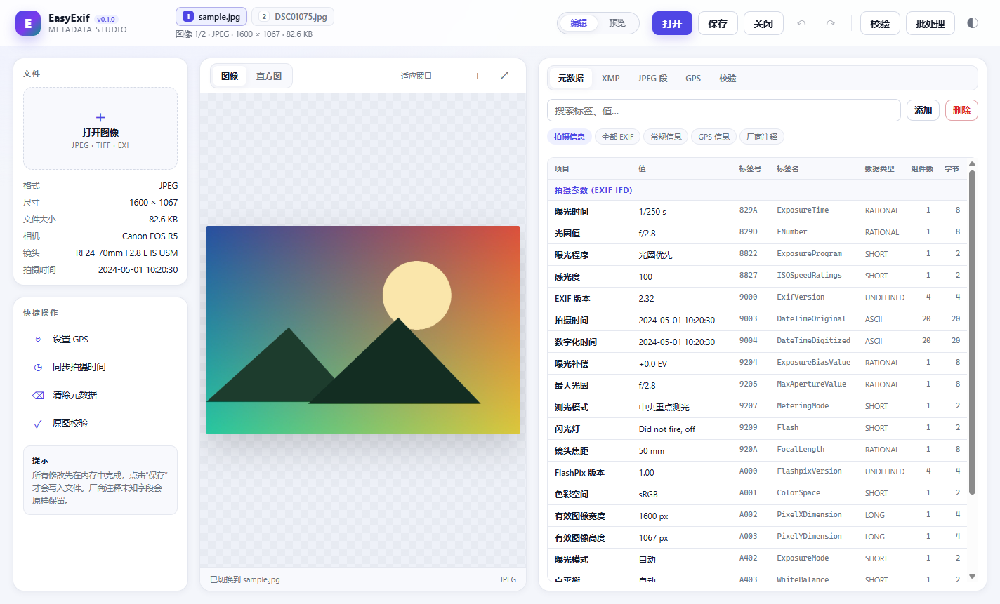

# EasyExif 0.1.1

一个用 Python 编写的开源 EXIF / XMP 元数据编辑器：无损读写 JPEG/TIFF 元数据、编辑 JPEG 段、解析厂商注释、GPS 坐标与坐标系转换、批量导出/重命名/分拣、元数据模板与文字戳，以及带 13 项检查的“原图可信度”报告。

> 所有格式实现均基于公开规范（TIFF 6.0、EXIF 2.32、XMP、JPEG/ITU-T T.81）独立完成；
> 不包含任何第三方私有代码、模板或特征库。

当前版本：**0.1.1**。命令行与桌面界面使用同一版本号，Windows 单文件 exe 也写入 0.1.1 文件版本资源。

## 目录

- [功能](#功能)
- [安装](#安装)
- [Windows 便携版（单 exe）](#windows-便携版单-exe)
- [命令行快速开始](#命令行快速开始)
- [图形界面](#图形界面)
- [Python API](#python-api)
- [批量处理](#批量处理)
- [模板与文字戳](#模板与文字戳)
- [JSON 元数据包与受限重建](#json-元数据包与受限重建)
- [RAW 只读与 Lensfun](#raw-只读与-lensfun)
- [设计说明](#设计说明)
- [限制与边界](#限制与边界)
- [测试](#测试)
- [界面截图](#界面截图)
- [许可](#许可)

## 功能

| 能力 | 状态 | 说明 |
| --- | --- | --- |
| EXIF/TIFF 读取与写回 | 已实现 | IFD0 / ExifIFD / GPS / Interop / IFD1，未知标签原样保留 |
| JPEG 段查看/编辑 | 已实现 | APP0/1/2/13/14、COM、DQT/DHT/SOF/SOS，可增删段、十六进制查看 |
| 无损元数据写入 | 已实现 | 不重新编码像素；熵编码扫描段按字节保留 |
| XMP 读写 | 已实现 | 保留未知属性/命名空间，支持 Alt/Seq/Bag |
| IPTC 读取 | 已实现 | APP13 Photoshop 8BIM / IIM 常用字段，只读 |
| 厂商注释解析 | 已实现 | Canon/Nikon/Sony/Olympus/Fujifilm/Pentax/Apple/Samsung/Panasonic/DJI |
| 厂商注释写回 | 部分 | Canon/Apple/Nikon type 1 重算绝对偏移；其余按原字节保留 |
| 缩略图读取/替换 | 已实现 | IFD1 JPEGInterchangeFormat |
| GPS 经纬度/海拔/时间 | 已实现 | 十进制、DMS、多种输入格式 |
| WGS-84 / GCJ-02 / BD-09 | 已实现 | 双向转换，含迭代回算 |
| 地图链接 | 已实现 | Google/Google CN/OSM/百度/高德/ArcGIS/Carto/Mapbox/Wikimedia |
| 地图瓦片/静态地图 | 部分 | 生成链接与可嵌入 HTML，不抓取瓦片 |
| 反向地理编码 | 可选 | 可选 Nominatim（显式联网） |
| 13 项原图校验 | 已实现 | 结构/软件痕迹/一致性/MPF/直方图/缩略图等启发式检查 |
| 现代 WebView2 界面 | 已实现 | pywebview + WebView2，无浏览器账户/扩展弹窗 |
| 批量 CSV 导出 | 已实现 | 兼容 .xpt 字段配置格式，内置 5 个配置 |
| 批量重命名/分拣 | 已实现 | 令牌模板、日期/相机/镜头分目录、干跑 |
| 元数据模板 | 已实现 | JSON 模板，可审阅、可版本管理 |
| 文字戳占位符 | 已实现 | 支持 [[EXIF.DateTimeOriginal {YYYY-MM-DD}]] 语法 |
| 时间平移/同步 | 已实现 | 支持按秒/天平移与 DateTime 同步 |
| JSON 元数据包 | 已实现 | 导出/导入 EXIF、XMP、IPTC、MakerNote、缩略图；无空白模板 |
| 元数据覆盖重建 | 已实现（受限） | 用户自带 JSON；不修改像素；强制写入 EasyExif 编辑标记 |
| RAW 只读 | 已实现（首批） | DNG/CR2/NEF/ARW 等 TIFF-based RAW；不写回 |
| Lensfun 镜头信息 | 可选 | 读取独立 Lensfun 数据包，做镜头匹配与焦段/光圈提示 |
| 直方图 | 已实现 | Web 界面内绘制 |
| 旋转/加噪/日期戳 | 未实现 | 属于像素编辑 |
| RAW 写回 | 未实现 | 当前只读；不写回 RAW 容器 |
| 原版式原图重构 | 不实现 | 不合成像素；仅支持用户自带 JSON 的元数据覆盖重建 |
| 激活/更新/联网 | 不实现 | 与元数据编辑无关 |

## 安装

要求 Python 3.10+。核心库零第三方依赖；图像预览、直方图和缩略图比较需要 Pillow。

~~~bash
git clone <your-fork-url> EasyExif
cd EasyExif

# 方式一：安装为命令
python -m pip install -e .

# 方式二：不安装，直接使用源码树
set PYTHONPATH=src        # Windows
export PYTHONPATH=src     # Linux / macOS
python -m easyexif --help
python -m easyexif --version
~~~

可选依赖：

~~~bash
# WebView2 桌面界面（pywebview + pythonnet）
python -m pip install -e ".[webui]"

# 预览 / 直方图 / 缩略图一致性
python -m pip install pillow
~~~

## Windows 便携版（单 exe）

发布产物是单个文件：

~~~text
dist/EasyExif.exe
~~~

- 目标系统：Windows 10/11，需系统自带 Microsoft Edge WebView2 Runtime（通常已安装）
- 不需要 Python、不需要安装、不写注册表
- 双击运行；数据目录优先 %LOCALAPPDATA%\EasyExif，若不可写会自动回退到 exe 同目录 EasyExifData 或其他可写目录
- 首次启动会解压内置运行时，约 1–3 秒
- 运行时解压到 exe 同目录的 .easyexif-runtime；请把 exe 放在可写目录
- 已改用固定 runtime 目录，不再依赖系统 TEMP，因此不会出现 Could not create temporary directory!
- 若 AppData、用户目录和 TEMP 都被拒绝访问，程序会使用 exe 同目录 EasyExifData；请确保 exe 所在目录可写
- 界面为真正的 WebView2 嵌入窗口，不经过 Edge 浏览器，因此没有账户同步、扩展或 AdBlock 弹窗
- exe 的文件版本与产品版本均为 0.1.1

构建命令见 packaging/build.ps1；若 PowerShell 执行策略阻止脚本，直接运行 packaging/build.cmd。

## 命令行快速开始

~~~bash
# 版本
easyexif --version

# 一览
easyexif info examples/sample.jpg

# 列出全部标签（JSON 便于二次处理）
easyexif dump examples/sample.jpg --json

# 读取单个字段
easyexif get examples/sample.jpg Model DateTimeOriginal GPSLatitude

# 写入字段（不改动像素，未知标签保留）
easyexif set photo.jpg Make=Canon Model="Canon EOS R5" DateTimeOriginal="2024:05:01 10:20:30" LensModel="RF24-70mm F2.8 L IS USM"

# GPS：写入并生成地图链接
easyexif gps photo.jpg --set 39.9087,116.3975,43.8 --map osm --map google

# 坐标系转换（WGS-84 -> GCJ-02 / BD-09）
easyexif gps photo.jpg --to gcj02

# 原图可信度报告
easyexif validate photo.jpg
easyexif validate photo.jpg --json

# JPEG 段
easyexif segments photo.jpg
easyexif segments photo.jpg --remove 3 --out clean.jpg
easyexif segments photo.jpg --extract 1 app1.bin

# 清除元数据（保留 JFIF/DQT/SOF 与像素）
easyexif strip photo.jpg --out clean.jpg
~~~

validate 的 13 项检查覆盖 EXIF 格式、第三方软件、厂商注释信度、压缩指纹、
内部/外部一致性、MPF、FlashPix、旧版编辑器数据、直方图、长宽比、内嵌图、图像尺寸。
实现是**可解释的启发式规则**，不是私有特征库。评分 1–5 仅表示证据强弱，不是司法鉴定结论。
第三方软件字段（Photoshop/Lightroom 等）、Adobe APP14 重编码、相机机型存在但 MakerNote
缺失、DateTime 与拍摄时间冲突等会触发警告或降级；MPF、FlashPix 等缺失不单独降级。
如果文件完全没有 EXIF/TIFF 目录，报告显示为“未知”，只列出缺失项，不会给出 1–5 级评分。

## 图形界面

### WebView2 界面（主界面）

~~~bash
easyexif webui                  # 空窗口
easyexif webui examples/sample.jpg
easyexif webui --version
~~~

现代三栏布局：左侧文件信息与快捷操作，中间图像预览/直方图，右侧检查器
（元数据树、XMP、JPEG 段、GPS、校验），顶部为打开/保存/关闭/撤销/重做/校验/批处理，
底部状态栏。支持把 JPEG/TIFF 直接拖入窗口打开；关闭有未保存修改的文件时会询问
保存、不保存或取消。元数据表显示：项目、值、标签号、标签名、数据类型、组件数、字节；
可按 拍摄信息（默认）/ 全部 EXIF / 常规信息 / GPS 信息 / 厂商注释 切换，
ExifIFDPointer 等结构指针默认隐藏。批处理为全屏覆盖层，支持 CSV 导出、
重命名、分拣与模板套用。

顶部 banner 还带有：

- **编辑 / 预览滑块**：预览模式保留完整三栏布局，只禁用编辑操作（保存、添加/删除标签、
  XMP 应用、GPS 写入、撤销/重做、批处理等），仍可查看元数据、运行校验和切换图像；
  再次滑动或按 `E` 返回编辑。
- **双图切换**：可同时打开两张图像，文件名标签位于标题栏，点击标签或按
  `Ctrl+Tab` 切换，`Ctrl+1` / `Ctrl+2` 直达；切换不会丢失另一张图的未保存修改。
- **上下文编辑提示**：双击标签打开编辑框时，提示会跟随当前标签变化，给出该标签的
  含义、输入格式和常用值（如方向、测光模式、色彩空间），并在输入时实时预览
  “将写入”的解析结果。
- **版本标识**：标题栏显示当前版本 0.1.1，与 CLI 和 exe 资源版本一致。

### Tkinter 旧界面（保留）

~~~bash
easyexif gui examples/sample.jpg
~~~

旧界面保留作为 fallback，功能较少，后续逐步退出。

## Python API

~~~python
from easyexif import Metadata, validate

meta = Metadata.read("examples/sample.jpg")

print(meta.summary())
print(meta.get_text("Model"))
print(meta.get_text("ExposureTime"), meta.get_text("FNumber"))

# 写入标准 EXIF
meta.set("Artist", "Zhang San")
meta.set("Copyright", "(c) 2024 Zhang San")
meta.set("DateTimeOriginal", "2024:05:01 10:20:30")

# GPS（默认 WGS-84，可指定 gcj02 / bd09）
meta.set_gps(39.9087, 116.3975, alt=43.8)

# XMP
meta.xmp.set("dc:title", ["A title"])
meta.xmp.set("dc:subject", ["travel", "beijing"])

meta.save("out.jpg", backup=True)   # 原子写入，可选 .bak

report = validate("out.jpg")
print(report.score, report.summary)
for check in report.checks:
    print(check.title, check.status, check.detail)
~~~

底层对象也可以单独使用：

~~~python
from easyexif.tiff import Tiff
from easyexif.jpeg import Jpeg

jpeg = Jpeg.parse(open("photo.jpg", "rb").read())
tiff = Tiff.parse(jpeg.exif_payload())
tiff.set("EXIF", 0xA434, "RF70-200mm F2.8 L IS USM")
jpeg.set_exif_payload(tiff.to_bytes())
open("out.jpg", "wb").write(jpeg.to_bytes())
~~~

## 批量处理

~~~bash
# 递归扫描并导出 CSV（内置配置：simple / detailed / photography / gps / file）
easyexif batch photos/ --csv report.csv --profile detailed

# 也支持 .xpt 字段配置
easyexif batch photos/ --csv report.csv --profile Exports/2_photography.xpt

# 按拍摄日期重命名（先干跑，确认后加 --apply）
easyexif batch photos/ --rename "{date}_{seq:03d}.{ext}"

# 按日期 / 相机 / 镜头分拣（默认复制）
easyexif batch photos/ --sort-by date --sort-root sorted/ --apply

# 批量套用模板
easyexif batch photos/ --template examples/copyright.template.json --apply
~~~

.xpt 字段配置格式：首行 # NAME:...，每行 IFD,tagHex，
IFD 编号 0=IFD0, 1=EXIF, 2=GPS, 3=Interop, 5=File。导出的 CSV 使用 UTF-8 BOM，
方便 Excel 直接打开中文。

## 模板与文字戳

模板是纯 JSON，可直接审阅和版本管理：

~~~json
{
  "name": "copyright",
  "description": "写入作者与版权",
  "exif": {
    "IFD0.Artist": "Zhang San",
    "IFD0.Copyright": "(c) 2024 Zhang San"
  },
  "xmp": {
    "dc:creator": ["Zhang San"],
    "dc:rights": "(c) 2024 Zhang San"
  },
  "options": {"sync_datetime": true}
}
~~~

文字戳占位符语法：

~~~bash
easyexif template stamp "[[EXIF.DateTimeOriginal {YYYY-MM-DD}]] [[IFD0.Model {'Unknown Model'}]]" photo.jpg
~~~

- [[TAG]]：取格式化值
- [[TAG {YYYY-MM-DD HH:MM:SS}]]：按日期格式重排
- [[TAG {'fallback'}]]：缺失时的默认文本
- {YYYY}、{YY}、{MM}、{DD}、{HH}、{mm}、{SS} 为日期标记

## JSON 元数据包与受限重建

从真实文件导出元数据包，不提供空白模板，也不兼容原版 `.exi`：

~~~bash
# 导出（只包含元数据，不含像素）
easyexif export photo.jpg -o photo.metadata.json

# 覆盖到同尺寸的 JPEG/TIFF；默认另存为新文件
easyexif reconstruct target.jpg photo.metadata.json -o target.reconstructed.jpg
~~~

规则：

- 只接受 EasyExif 导出的版本化 JSON；`.exi` 会被拒绝
- 目标尺寸/比例必须与元数据包来源一致
- 不修改 JPEG 扫描数据或 TIFF 像素
- 每次重建都会写入 `EXIF Software`、`xmp:CreatorTool`、`photoshop:History`
  和 `easyexif:*` 标记，显示由 EasyExif 编辑
- 这是元数据覆盖，不是无痕原图伪造；标记可被其他工具删除

## RAW 只读与 Lensfun

首批 RAW 采用只读模式：DNG、CR2、NEF、ARW 等 TIFF-based RAW。
可读取 EXIF/GPS/MakerNote 和嵌入预览；不提供写回。DNG 已用样本验证，
CR2/NEF/ARW 仍需更多真实样张回归。

~~~bash
easyexif lens photo.dng
~~~

镜头信息使用可选的 Lensfun 数据包：

~~~text
EASYEXIF_LENSFUN_DIR=F:\EasyExif\lensfun
~~~

Lensfun 数据通常为 CC BY-SA 3.0，需作为独立数据包保留署名和许可证；
不随 exe 内置，也不默认联网下载。详见 [docs/LENSFUN.md](docs/LENSFUN.md)。

## 设计说明

~~~text
src/easyexif/
  tags.py       标签字典、类型、人类可读格式化
  tiff.py       TIFF/EXIF 解析与重建（偏移重算、IFD 链、缩略图）
  makernote.py  厂商注释识别、字段解码、必要的偏移重编码
  jpeg.py       JPEG 段解析/重建、APP1/APP2/APP13、MPF、IPTC、量化表
  xmp.py        XMP 包解析与“定点替换”写入（保留未知内容）
  gps.py        DMS/十进制、WGS-84/GCJ-02/BD-09、地图链接
  metadata.py   统一门面：读取、修改、保存、时间平移、GPS
  validate.py   13 项原始性/一致性检查与 1–5 评分
  template.py   JSON 模板与文字戳
  batch.py      CSV/JSON 导出、重命名、分拣
  cli.py        命令行
  gui.py        Tkinter 旧界面
  webui/        WebView2 界面
    server.py   本地 HTTP 服务（127.0.0.1 + token）
    api.py      JSON API
    session.py  文档会话、快照撤销
    shell.py    pywebview / WebView2 窗口（无浏览器回退）
    static/     HTML/CSS/ES Modules
~~~

写入策略：

1. **像素零改动**：JPEG 只替换/增删元数据段，SOS 之后的熵编码数据原样拼回。
2. **未知标签保留**：未修改的 TIFF 条目使用原始字节；修改过的条目才重新编码。
3. **厂商注释**：Canon / Apple / Nikon type 1 的偏移相对 TIFF 头，重建时重算；
   其余厂商注释（Nikon type 3、Sony、Olympus、Fujifilm、Pentax、DJI 等）偏移相对注释自身，
   整体复制即可保持有效。
4. **原子保存**：先写同目录临时文件再 os.replace，避免半写坏文件。

## 限制与边界

- **不做原版式像素合成“原图重构”**。该功能会从样张模板合成看似“相机原图”的像素与元数据，实质是伪造拍摄来源。
  当前只提供用户自带 JSON 的元数据覆盖重建，并强制写入 EasyExif 编辑标记；不提供空白模板或原版 `.exi` 模板。
- **校验不是取证**。13 项检查基于文件结构与常见软件痕迹，能被有意的清洗/伪造绕过；
  报告中的 1–5 级只是启发式评分；没有 EXIF/TIFF 数据时只报告“未知”。
- **厂商注释字典不完整**。只收录常用字段；未知字段仍会显示 tag 编号并原样保留。
- **不解析 RAW 像素**。TIFF 容器可读写，但 CR2/NEF/ARW 等专有 RAW 结构未实现。
- **地图默认不联网**。gps --map 只生成链接；反向地理编码是显式可选调用。
- **IPTC 只读**。APP13/IIM 可解析展示，写回未实现。
- **XMP 写入是定点替换**。极端嵌套/重复属性可能需要人工检查。
- **重建有边界**。只做用户自带 JSON 的元数据覆盖，不提供空白模板、不兼容 `.exi`、
  不修改像素；必须另存为新文件，并写入 EasyExif 编辑标记。
- **RAW 只读**。当前不写回 RAW；CR2/NEF/ARW 的实际兼容性仍需更多样张验证。
- **Lensfun 可选**。没有数据包时只显示“未加载”，不会误报镜头范围。
- **编辑标记不是不可移除的**。其他工具仍可删除 `Software`/XMP 标记；EasyExif 只保证写入。

## 测试

~~~bash
set PYTHONPATH=src
python -m unittest discover -s tests -v
~~~

测试覆盖：TIFF 大小端往返、未知标签保留、JPEG 扫描段逐字节保留、EXIF/XMP 注入、
厂商注释偏移重编码、GPS 转换、XMP 未知属性保留、模板占位符、13 项校验、CSV/重命名/分拣，
以及 Web UI 的鉴权、打开/编辑/撤销/保存、预览、直方图、段、校验、批量接口、
双图切换和上下文编辑提示，以及 JSON 元数据包、受限重建、RAW 只读和 Lensfun 匹配。
共 60 个测试。

## 界面截图

- [docs/webui.png](docs/webui.png)：WebView2 编辑界面（双图标签）
- [docs/webui-preview.png](docs/webui-preview.png)：只读预览模式（保留布局，禁用编辑）
- [docs/webui-editor.png](docs/webui-editor.png)：上下文编辑提示
- [docs/WEBVIEW-GUI-PLAN.md](docs/WEBVIEW-GUI-PLAN.md)：Windows WebView2 方案与依赖检查

## 许可

MIT，见 [LICENSE](LICENSE)。
